# B6-1. 웹사이트를 인터넷에 올려 누구나 쓰게 하기

AWS VPC 기반 네트워크를 직접 설계하고, Public Subnet의 EC2에 Nginx 웹 서버를 배포하여
외부에서 접속 가능한 웹 서비스를 구성한 실습 결과물입니다.

> **현재 상태: 실습 완료 및 AWS 리소스 정리 완료 (2026-10-05), 문서 최종 정리 (2026-10-06).**
> 아래 퍼블릭 IP(`43.201.17.39`)는 인스턴스 종료와 함께 반납되어 더 이상 접속되지 않습니다.
> 리소스가 모두 삭제되었으므로, 구성·동작·정리 결과는 문서에 남긴 증빙으로 확인합니다.
> 단계별 증빙(스크린샷·터미널 출력 기록)이 붙어 있는 [`docs/execution-report.md`](./docs/execution-report.md)
> (PDF 판: [`docs/execution-report.pdf`](./docs/execution-report.pdf))를 먼저 보시면 전체 과정을 순서대로 따라갈 수 있습니다.

## 작업 타임라인

| 날짜 | 내용 |
|---|---|
| 2026-09-28 | AWS 계정 가입, 최소 권한 IAM 정책·사용자(`mission-b61-user`) 생성 — 루트 계정은 여기까지만 사용 |
| 2026-09-29 | IAM 사용자로 VPC → 서브넷 → IGW → 라우팅 → 보안 그룹 → EC2 구축, SSH 접속·Nginx 설치·내부 검증(Nginx 실행 확인 오후 4:09), 외부 브라우저 접속 확인(오후 4:16) |
| 2026-10-05 | 삭제 전 증빙 확보·서류 백업 후, 과금될 수 있는 리소스를 의존성 순서대로 모두 삭제 |
| 2026-10-06 | 정리 결과를 반영해 문서 최종화, 실행보고서에 단계별 증빙 연결(PDF 판 추가), 최종 백업 |

## 1. 아키텍처 개요

- 리전: `ap-northeast-2` (서울)
- VPC: `10.0.0.0/16`
- Public Subnet: `10.0.1.0/24` (AZ: `ap-northeast-2a`)
- Internet Gateway → Route Table(`0.0.0.0/0 → IGW`) → EC2
- 상세 다이어그램: [`docs/architecture.png`](./docs/architecture.png)

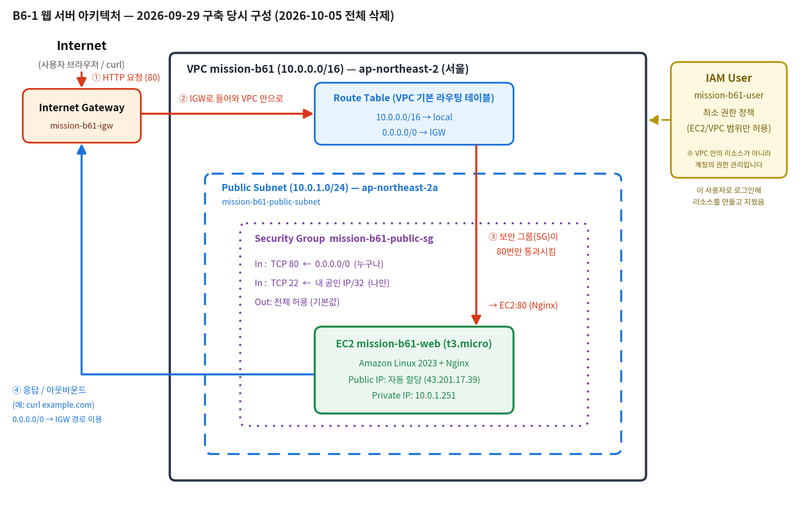

## 2. 리소스 구성 요약

| 구성 요소 | 값 |
|---|---|
| VPC ID | `vpc-03346273d144412dd` (`mission-b61`) |
| Subnet ID | `subnet-0b33477b04e1f5a9f` (`mission-b61-public-subnet`) |
| Internet Gateway ID | `igw-016323813992e2cf6` (`mission-b61-igw`) |
| Route Table ID | `rtb-061cce12216f0da91` (VPC 기본 라우팅 테이블) |
| Security Group ID | `sg-021c333abe2694a47` (`mission-b61-public-sg`) |
| EC2 Instance ID | `i-03d20dd8d7eb3263a` (`mission-b61-web`) |
| 인스턴스 유형 | t3.micro (프리 티어 사용 가능) |
| AMI | Amazon Linux 2023 (`ami-0d646dff0c3609377`) |
| 키 페어 | `mission-b61-key` (RSA, `.pem`) |
| 퍼블릭 IP | `43.201.17.39` |
| 프라이빗 IP | `10.0.1.251` |

> 위 리소스는 모두 2026-10-05에 삭제했습니다(IAM 사용자·정책 제외, 8장 참고).
> 생성 화면은 실행보고서 2~7단계, 삭제 전 구성 화면은 13단계에서 볼 수 있습니다.

**생성 화면 (2~7단계)**

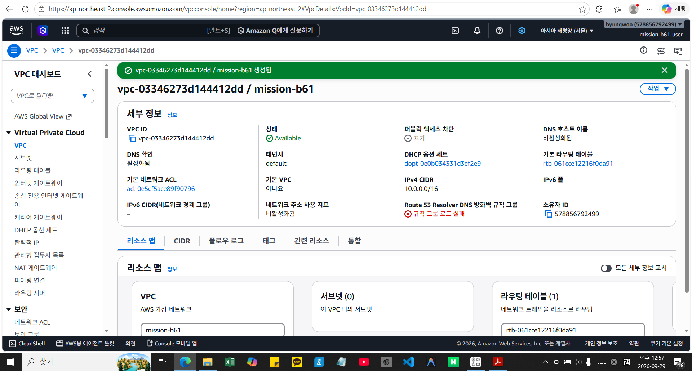

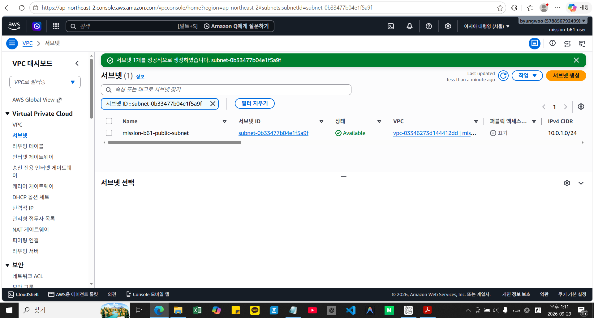

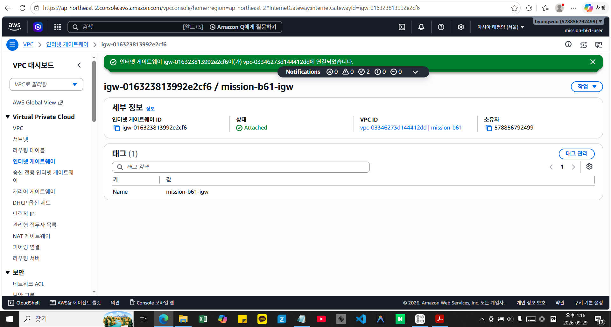

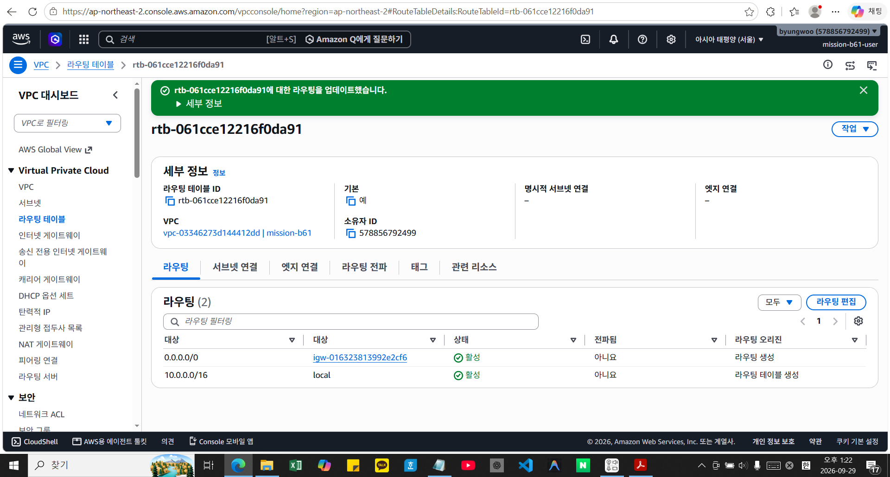

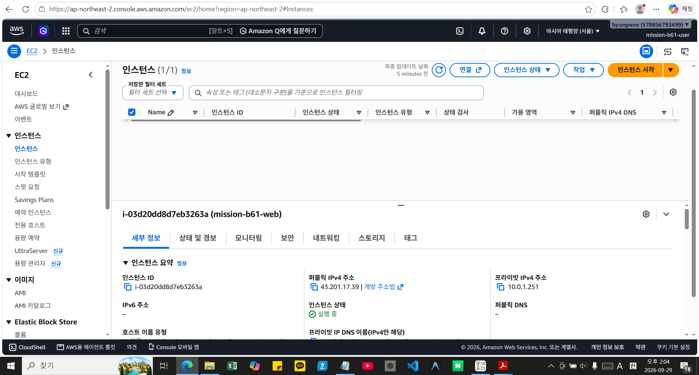

**삭제 직전 구성 화면 (13단계)**

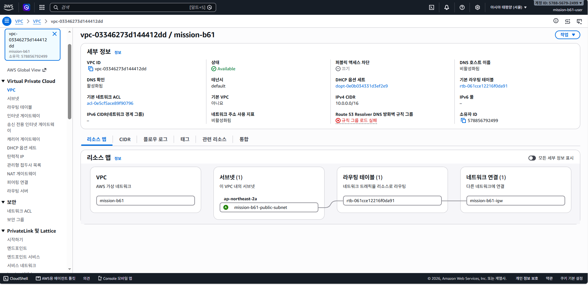

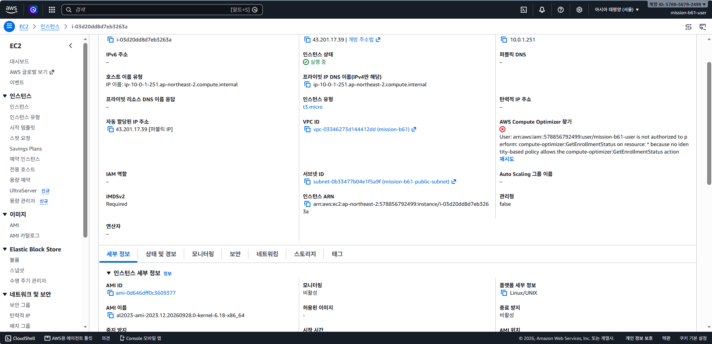

## 3. 보안 그룹 인바운드 규칙

| 프로토콜 | 포트 | 소스 | 용도 |
|---|---|---|---|
| TCP | 80 | `0.0.0.0/0` | 웹 서비스 공개 접근 |
| TCP | 22 | 내 공인 IP `/32` | 관리자 SSH 접속 (최소 권한) |

- 아웃바운드는 기본값(전체 허용)을 유지했습니다(패키지 설치와 `curl` 외부 접속 확인에 필요).
- 0.0.0.0/0에 대한 전체 포트(0-65535) 허용 규칙은 생성하지 않았습니다.
- 증빙: 생성 화면은 실행보고서 6단계(`step06-sg-form.png`, `step06-sg-created.png`),
  삭제 직전 규칙 화면은 13단계(`evidence-sg-rules.png`).

**규칙 입력 화면 (6단계)**

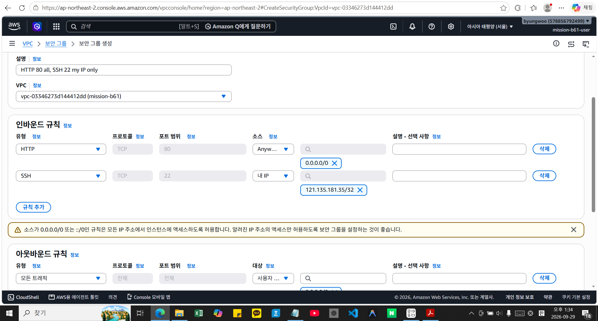

**생성 완료 화면 (6단계)**

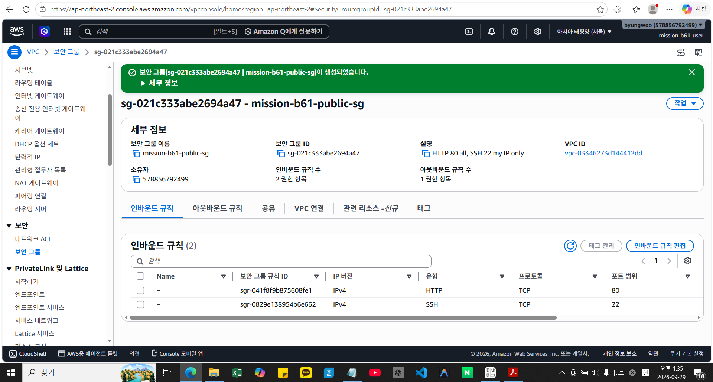

**삭제 직전 규칙 화면 (13단계)** — 80/TCP는 `0.0.0.0/0`, 22/TCP는 내 IP `/32`

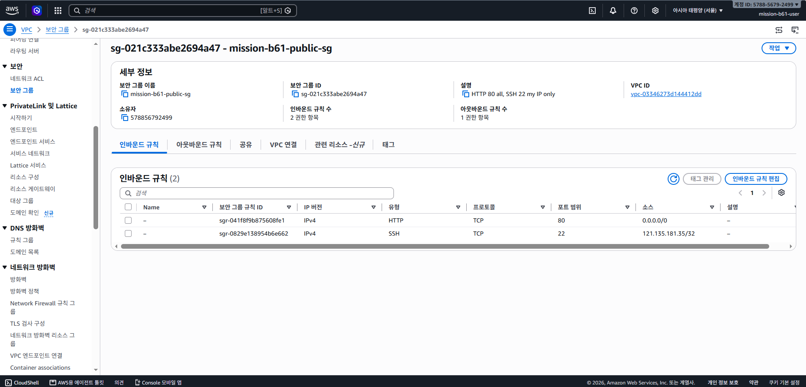

## 4. IAM 최소 권한

실습에는 관리자 권한(AdministratorAccess) 대신, EC2/VPC 리소스 생성·조회·삭제 범위로
제한한 커스텀 정책을 연결한 IAM 사용자를 사용했습니다. VPC·서브넷·IGW·라우팅 테이블·
보안 그룹·EC2 인스턴스 생성부터 웹 서버 설치·검증, 리소스 정리까지 전 과정을 이 사용자로 진행했고,
루트 계정은 계정 가입과 IAM 사용자 생성에만 사용했습니다.

- IAM 사용자: `mission-b61-user`
- 연결 정책: `MissionB61-EC2VPC-LeastPrivilege` (EC2/VPC 리소스 범위로 제한, S3·RDS 등 무관한 서비스 권한 없음)
- 증빙: 실행보고서 0단계 (`step00-iam-policy-json.png`, `step00-iam-policy-created.png`,
  `step00-iam-user-review.png`, `step00-iam-user-list.png`)

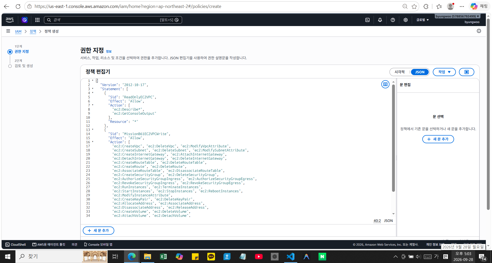

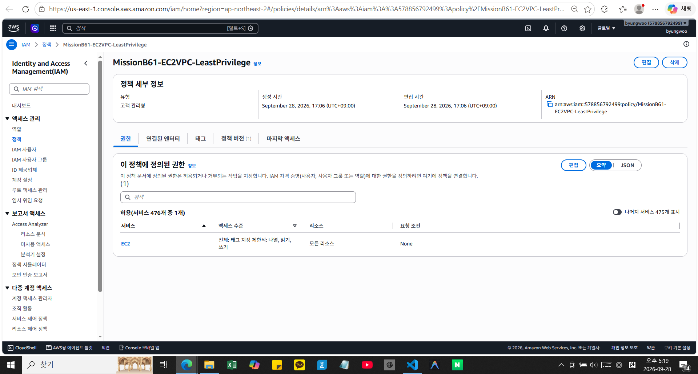

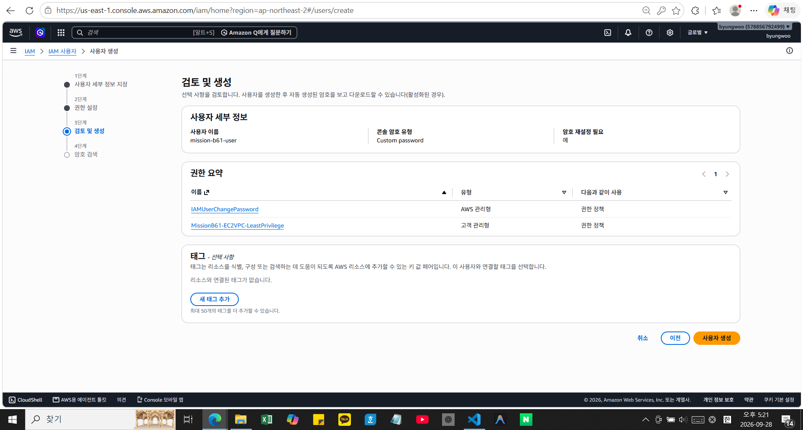

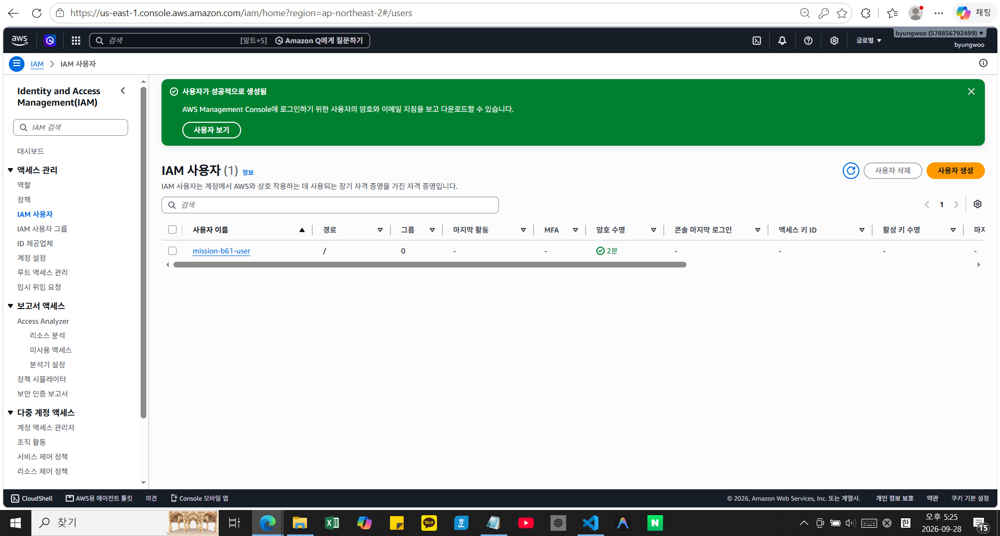

## 5. 외부 접속 검증

- **선택한 방식**: (A) 브라우저 접속
- **접속 정보**: `http://43.201.17.39`
- **검증 결과**: "Welcome to nginx!" 기본 페이지 정상 응답 확인 (2026-09-29 오후 4:16)

**외부 접속 확인 스크린샷** (같은 화면을 처음 저장한 원본 파일명은 `external-access.png`)

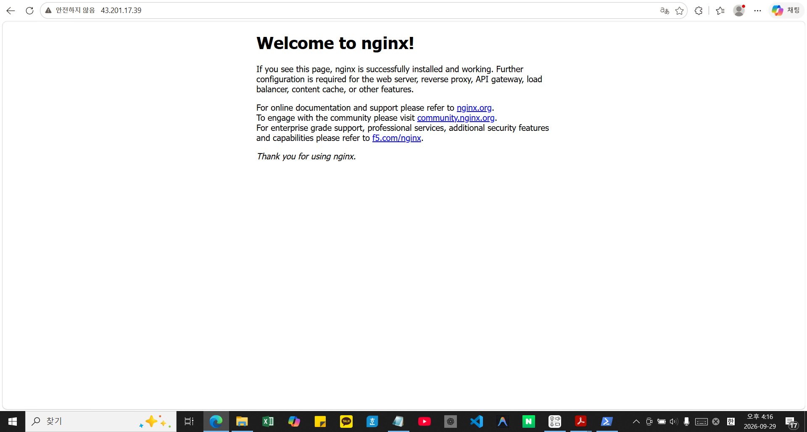

## 6. 인스턴스 내부 검증

```bash
# 웹 서버 프로세스 상태 → active (running) 확인
systemctl status nginx

# 로컬 응답 확인 → HTTP/1.1 200 OK 확인
curl -i http://localhost

# 아웃바운드 통신 확인 → HTTP/2 200 확인
curl -I https://example.com
```

SSH 접속 명령 (Windows PowerShell, Amazon Linux 2023 기본 사용자는 `ec2-user`).
키 파일 권한을 현재 사용자 읽기 전용으로 제한한 뒤 접속합니다.

```powershell
icacls mission-b61-key.pem /inheritance:r
icacls mission-b61-key.pem /grant:r "$($env:USERNAME):(R)"
ssh -i mission-b61-key.pem ec2-user@43.201.17.39
```

웹 서버 설치 명령 (Amazon Linux 2023, `dnf` 패키지 관리자 사용):

```bash
sudo dnf install -y nginx
sudo systemctl enable --now nginx
```

작업 당시(2026-09-29) 터미널 출력으로 확인한 결과입니다.

| 확인 항목 | 결과 |
|---|---|
| SSH 접속 | 성공, 프롬프트 `[ec2-user@ip-10-0-1-251 ~]$` (프라이빗 IP `10.0.1.251`과 일치) |
| Nginx 설치 | `nginx 1.30.5` 외 의존 패키지 포함 7개 설치 완료 |
| `systemctl status nginx` | `enabled`(재부팅 시 자동 시작), `Active: active (running)` |
| `curl -i http://localhost` | `HTTP/1.1 200 OK`, `Server: nginx/1.30.5`, 본문 "Welcome to nginx!" |
| `curl -I https://example.com` | `HTTP/2 200` — 인스턴스에서 인터넷으로 나가는 경로 정상 |

터미널 출력 발췌 원문은 실행보고서 8~10단계에 있습니다.

## 7. 문서 목록과 증빙 위치

- [`docs/execution-report.md`](./docs/execution-report.md) — 단계별 실행보고서 (증빙 연결본)
- [`docs/execution-report.pdf`](./docs/execution-report.pdf) — 같은 내용의 PDF 판 (이미지 포함)
- [`docs/architecture.png`](./docs/architecture.png) — 아키텍처 다이어그램
- [`docs/troubleshooting.md`](./docs/troubleshooting.md) — 트러블슈팅 보고서
- [`docs/cleanup-checklist.md`](./docs/cleanup-checklist.md) — 리소스 정리 체크리스트 (정리 완료 기록)
- [`docs/screenshots/`](./docs/screenshots/) — 증빙 스크린샷 모음

실행보고서 단계별 증빙은 아래와 같습니다.

| 실행보고서 단계 | 증빙 형태 | 파일 |
|---|---|---|
| 0. 사전 조건 (IAM 정책·사용자) | 스크린샷 | `step00-…png` |
| 1~7. 로그인·VPC·서브넷·IGW·라우팅·보안 그룹·EC2 | 스크린샷 | `step01-…` ~ `step07-…png` |
| 8~10. SSH·Nginx 설치·내부 검증 | 터미널 출력 기록(발췌) | 실행보고서 본문 |
| 11. 외부 접속 검증 | 스크린샷 | `step11-nginx-external.png` |
| 12. 산출물 문서 완성 | 스크린샷 | `step12-folder-docs.png` |
| 13. 리소스 정리 | 삭제 전·삭제 과정·삭제 후 스크린샷 | `evidence-…png`, `cleanup-…png` |

증빙 화면에 대한 안내입니다.

- 스크린샷은 작업 당시 직접 캡처한 것입니다. `step…` 화면은 맨 윗줄(브라우저 탭 목록)만 잘라냈고, 13단계의 `evidence-…`/`cleanup-…` 화면은 저장해 둔 원본 그대로입니다.
- 8~10단계는 화면 캡처 대신 작업 당시 터미널 출력 기록에서 발췌했고, 생략한 부분은 `(중략)`으로 표시했습니다.
- 화면 오른쪽 위에는 작업 계정(`byungwoo`) 정보가 보입니다.
- SSH 키 파일(`mission-b61-key.pem`)은 비밀 값이라 제출·백업 자료에 포함하지 않았습니다. 키 페어도 AWS에서 삭제했습니다.

## 8. 리소스 정리 결과 (2026-10-05)

과금될 수 있는 리소스를 모두 삭제하고 삭제 전후 화면으로 확인했습니다.
순서는 EC2 종료 → EBS 볼륨 확인 → 보안 그룹 → IGW 분리·삭제 → 서브넷 → VPC → 키 페어입니다.
삭제 확인 창마다 대상 ID가 의도한 것 하나뿐인지 확인한 뒤 진행했고, AWS 기본 VPC 관련 리소스는 건드리지 않았습니다.

| 확인 항목 | 결과 |
|---|---|
| VPC 대시보드 (삭제 전 → 후) | VPC 2→1, 서브넷 5→4, 라우팅 테이블 2→1, IGW 2→1, 네트워크 ACL 2→1, 보안 그룹 3→1 (남은 것은 AWS 기본 VPC 기본값) |
| EC2 대시보드 (키 페어 삭제 직전 캡처) | 인스턴스(실행 중) 0, 볼륨 0, 탄력적 IP 0, 보안 그룹 1(기본 VPC 기본값). 이 시점에는 키 페어 카드가 1로 표시됨 |
| 키 페어 목록 (삭제 직후) | "1개의 키 페어 삭제 완료" 알림과 "표시할 키 페어 없음" 확인 |
| 결제 화면 | IAM 최소 권한 사용자는 조회 불가("액세스 거부됨"), 대체 증빙으로 위 리소스 0개 화면 사용 |

**삭제 전 VPC 대시보드**

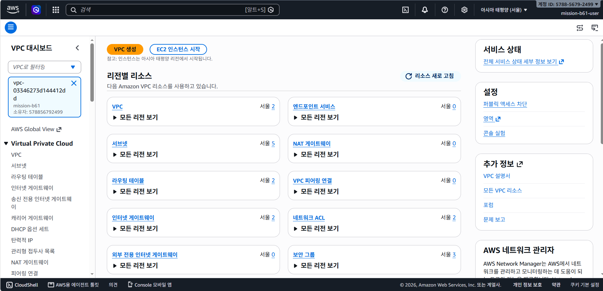

**삭제 후 VPC 대시보드**

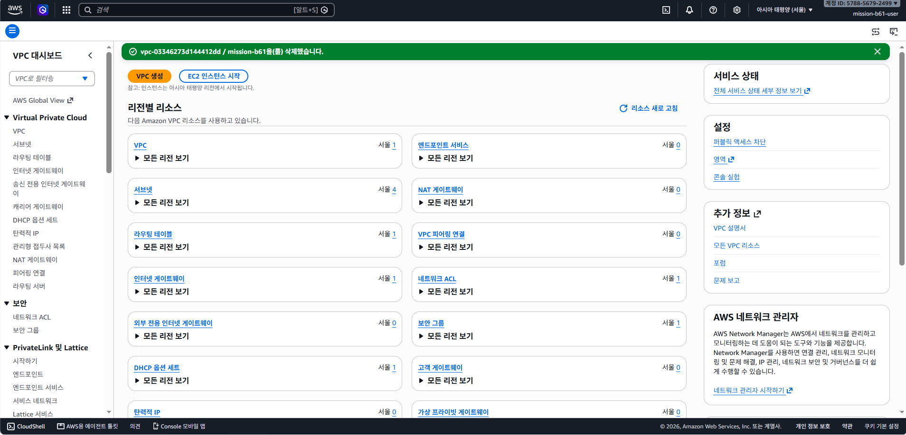

**삭제 후 EC2 대시보드**

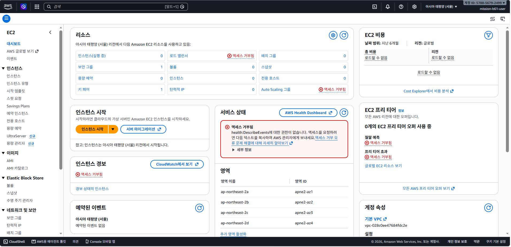

**키 페어 삭제 직후**

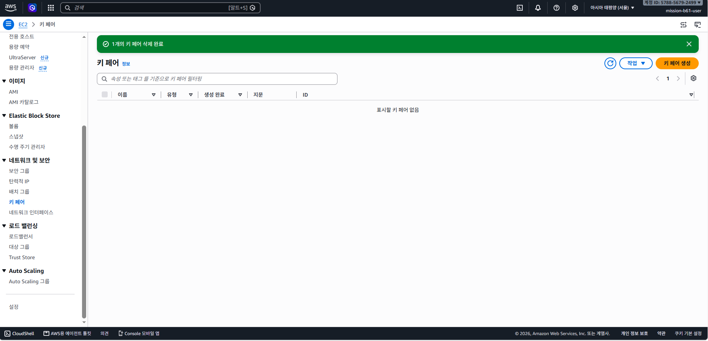

**결제 화면 접근 거부(IAM 최소 권한 확인)**

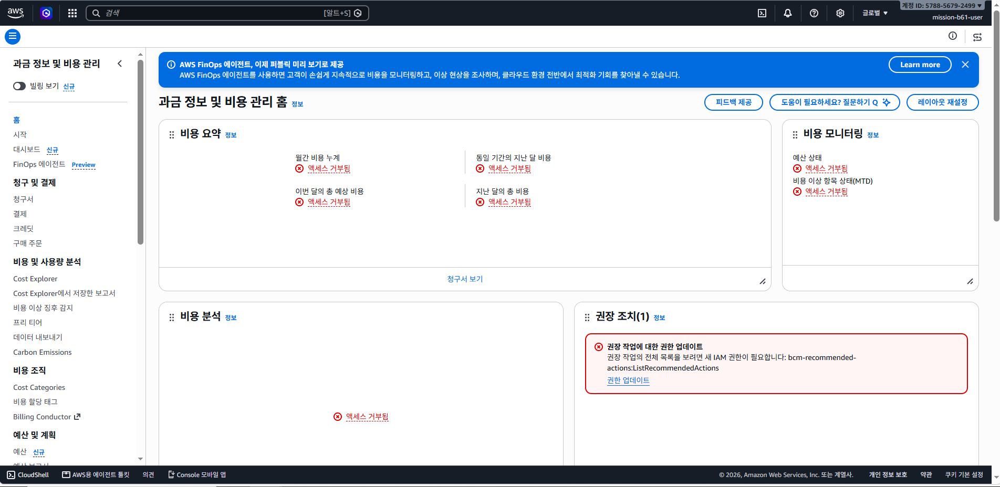

IAM 사용자·정책은 요금이 없는 리소스라 이번 정리 대상에서 제외하고 유지했습니다(필요 없어지면 콘솔 IAM에서 삭제).
삭제 단계별 증빙 파일명은 [`docs/cleanup-checklist.md`](./docs/cleanup-checklist.md)와 실행보고서 13단계를 참고하세요.

## 9. (선택) 보너스

- [ ] 보너스 1 — HTTPS 적용 (도메인 + Let's Encrypt)
- [ ] 보너스 2 — Docker 컨테이너로 웹 서비스 배포
