# B6-1 실행보고서 — 웹사이트를 인터넷에 올려 누구나 쓰게 하기

| 항목 | 내용 |
|---|---|
| 작업일 | 구축·검증 2026-09-29, 리소스 정리 2026-10-05 (전일 2026-09-28에 AWS 계정 가입 및 IAM 사용자 생성 선행) |
| 수행자 | 병우 (구축·정리는 IAM 사용자 `mission-b61-user`로 수행. 루트 계정은 계정 가입과 IAM 사용자 생성에만 사용) |
| 리전 | 아시아 태평양(서울) `ap-northeast-2` |
| 목표 | VPC 기반 네트워크를 직접 설계·구축하고 Public Subnet의 EC2에 Nginx를 배포하여 외부에서 접속 가능한 웹 서비스를 구성 |
| 최종 결과 | **성공 후 정리 완료** — `http://43.201.17.39` 브라우저 접속으로 "Welcome to nginx!" 페이지 확인(2026-09-29). 2026-10-05에 실습 리소스를 모두 삭제해 현재 이 주소는 접속되지 않음 |

> **스크린샷 안내** — 아래 화면은 작업 당시 직접 캡처한 것입니다. 화면 맨 윗줄(브라우저 탭 목록)만 잘라냈고 나머지는 그대로입니다.
> 단계별 화면은 [`screenshots/`](./screenshots/) 폴더의 `stepNN-…png` 파일이며, 13단계(정리)는 기존 `evidence-…`/`cleanup-…` 파일을 사용합니다.
> 8~10단계(SSH·Nginx 설치·내부 검증)는 화면 캡처 대신 작업 당시(2026-09-29) 터미널 출력 기록에서 발췌해 넣었습니다. 생략한 부분은 `(중략)`으로 표시했고, 줄이 너무 길어 보이는 일부는 공백만 줄였습니다.
> 화면 오른쪽 위에는 작업 계정(`byungwoo`) 정보가 보입니다.

## 0. 사전 조건 (2026-09-28 완료분)

오늘 작업을 시작하기 전, 전날 아래 항목이 이미 완료되어 있었다.

- AWS 신규 계정 가입 및 활성화 (Free 플랜, $100~$200 크레딧, 6개월)
- 관리자 권한(AdministratorAccess) 대신 EC2/VPC 범위로 제한한 IAM 정책 `MissionB61-EC2VPC-LeastPrivilege` 생성
- 이 정책을 연결한 IAM 사용자 `mission-b61-user` 생성, 콘솔 로그인 및 비밀번호 변경 완료

오늘 작업은 이 IAM 사용자로 로그인한 상태에서 이어서 진행했다.

**증빙 화면 (2026-09-28)**


*IAM 정책 편집기(JSON). 조회(`ec2:Describe*`)와 VPC·EC2 생성·삭제 작업만 허용하고 S3·RDS 등 다른 서비스 권한은 넣지 않음*


*정책 `MissionB61-EC2VPC-LeastPrivilege` 생성 확인 — 허용 서비스 476개 중 EC2 1개만 허용*


*사용자 `mission-b61-user` 생성 직전 검토 화면 — 연결된 정책은 `IAMUserChangePassword`(첫 로그인 시 비밀번호 변경용)와 위 최소 권한 정책뿐*


*"사용자가 성공적으로 생성됨" 알림과 IAM 사용자 목록*

## 1. 단계별 실행 내역

### 1단계 — 로그인 및 리전 확인

- **목적**: 실습 전 과정을 IAM 사용자로, 서울 리전에서 진행하는지 확인
- **실행 내용**: `mission-b61-user` 전용 로그인 URL로 콘솔 접속. 세션이 유지되어 있어 재로그인 없이 진행
- **결과**: 화면 오른쪽 위에 `mission-b61-user` 표시, 리전 "아시아 태평양(서울)" 확인

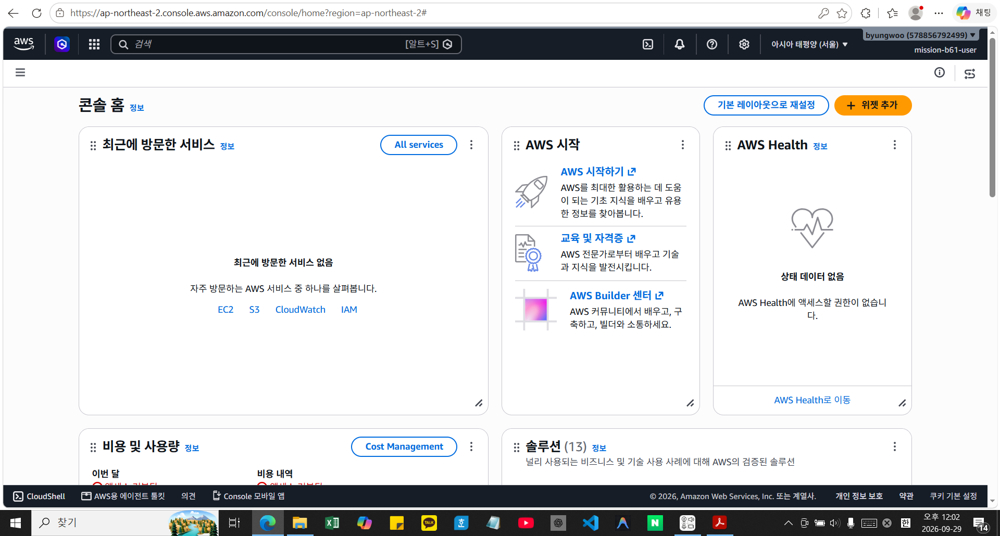

*콘솔 홈 — 오른쪽 위에 IAM 사용자 `mission-b61-user`, 리전 "아시아 태평양(서울)"*

### 2단계 — VPC 생성

- **목적**: 과제 네트워크의 최상위 컨테이너 생성
- **설정값**: 이름 `mission-b61`, CIDR `10.0.0.0/16`, "VPC만" 옵션 선택(서브넷·NAT 게이트웨이 자동 생성 방지)
- **결과**: `vpc-03346273d144412dd` 생성 확인, 상태 Available


*"vpc-03346273d144412dd / mission-b61 생성됨" 알림, 상태 Available, IPv4 CIDR `10.0.0.0/16`, 기본 라우팅 테이블 `rtb-061cce12216f0da91`*

### 3단계 — Public Subnet 생성

- **목적**: EC2가 위치할 퍼블릭 서브넷 생성
- **설정값**: 이름 `mission-b61-public-subnet`, VPC `vpc-03346273d144412dd`, 가용 영역 `ap-northeast-2a`, CIDR `10.0.1.0/24`
- **결과**: `subnet-0b33477b04e1f5a9f` 생성 확인 (256 IP)
- **참고**: CIDR 입력 칸에 값이 반영되지 않는 문제 발생 → [트러블슈팅 #2](./troubleshooting.md) 참조

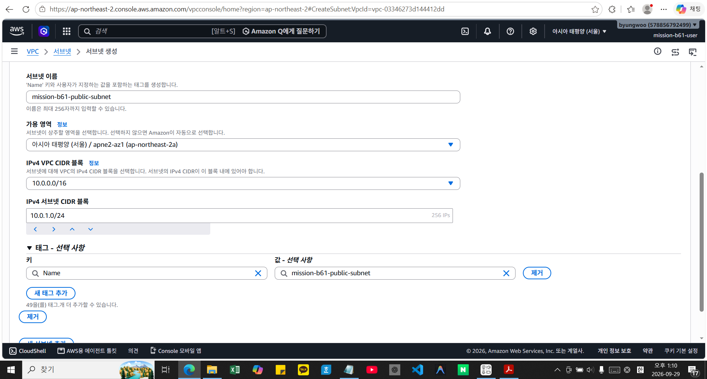

*서브넷 생성 입력 — 이름 `mission-b61-public-subnet`, 가용 영역 `ap-northeast-2a`, VPC 블록 `10.0.0.0/16`, 서브넷 CIDR `10.0.1.0/24`(256 IPs)*


*"서브넷 1개를 성공적으로 생성하였습니다. subnet-0b33477b04e1f5a9f", 상태 Available, IPv4 CIDR `10.0.1.0/24`*

### 4단계 — Internet Gateway 생성 및 연결

- **목적**: VPC를 인터넷과 연결
- **실행 내용**: `mission-b61-igw` 생성 후 `vpc-03346273d144412dd`에 연결(Attach)
- **결과**: `igw-016323813992e2cf6` 생성, 상태 Detached → Attached로 전환 확인

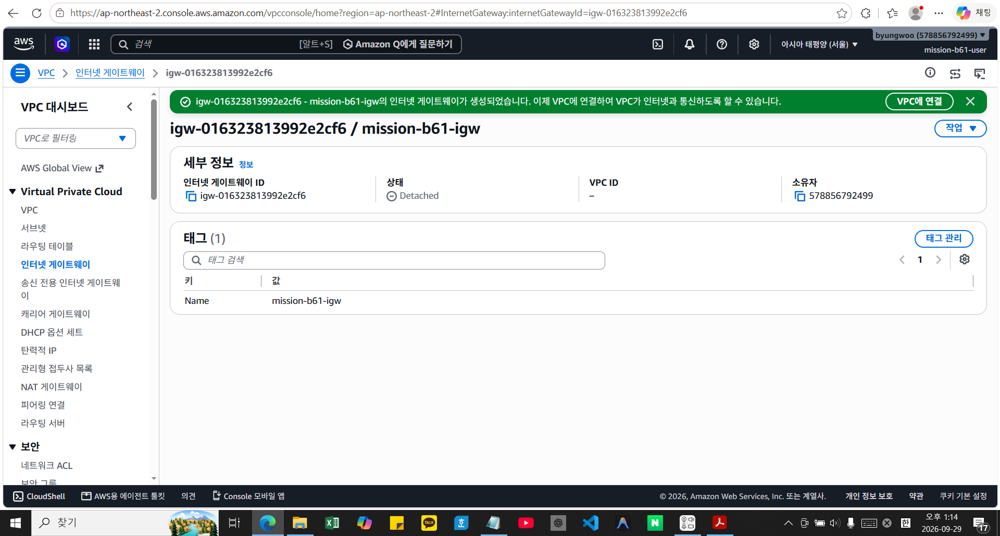

*생성 직후 — 상태 **Detached**, VPC ID 비어 있음(아직 VPC에 연결 전)*


*"igw-016323813992e2cf6이(가) vpc-03346273d144412dd에 연결되었습니다", 상태 **Attached***

### 5단계 — 라우팅 테이블 경로 추가

- **목적**: Public Subnet에서 인터넷으로 나가는 경로 확보
- **실행 내용**: VPC 생성 시 자동 생성된 기본 라우팅 테이블 `rtb-061cce12216f0da91`에 `0.0.0.0/0 → igw-016323813992e2cf6` 경로 추가
- **결과**: 라우팅 2건(로컬 `10.0.0.0/16`, 인터넷 `0.0.0.0/0`) 확인. "서브넷 연결" 탭에서 `mission-b61-public-subnet`이 이 기본 라우팅 테이블에 자동 연결되어 있음을 확인


*"rtb-061cce12216f0da91에 대한 라우팅을 업데이트했습니다" — 라우팅 2건: `0.0.0.0/0 → igw-016323813992e2cf6`(활성), `10.0.0.0/16 → local`(활성)*

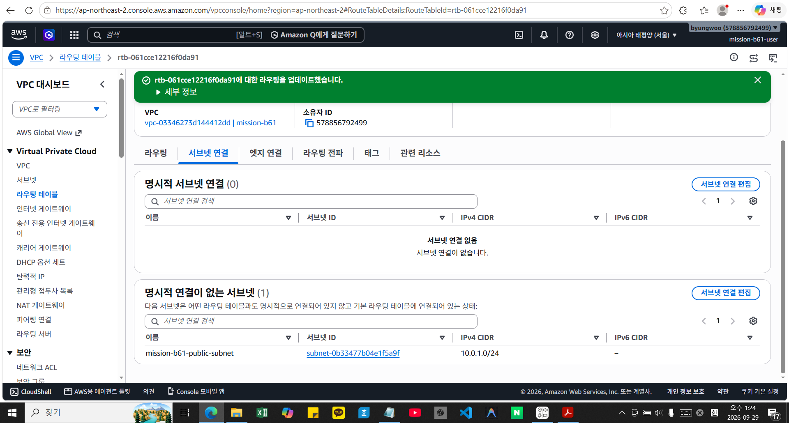

*"서브넷 연결" 탭 — 명시적 연결은 없고, "명시적 연결이 없는 서브넷"에 `mission-b61-public-subnet`(`10.0.1.0/24`)이 있음 = 기본 라우팅 테이블을 그대로 사용 중*

### 6단계 — 보안 그룹 생성

- **목적**: 인스턴스 접근 제어(웹은 공개, SSH는 관리자만)
- **설정값**: 이름 `mission-b61-public-sg`, VPC `vpc-03346273d144412dd`
  - 인바운드: TCP 80 ← `0.0.0.0/0`, TCP 22 ← 내 공인 IP `121.135.181.35/32`
  - 아웃바운드: 기본값(전체 허용) 유지
- **결과**: `sg-021c333abe2694a47` 생성, 인바운드 규칙 2건·아웃바운드 규칙 1건 확인


*보안 그룹 생성 입력 — VPC `mission-b61`, 인바운드 HTTP(80) ← `0.0.0.0/0`, SSH(22) ← "내 IP" `/32`. 화면 중간의 노란 경고는 0.0.0.0/0 규칙에 대한 일반 안내(HTTP 공개는 의도한 설정)*


*"보안 그룹(sg-021c333abe2694a47 | mission-b61-public-sg)이 생성되었습니다", 인바운드 규칙 2 권한 항목·아웃바운드 1 권한 항목 (HTTP 80, SSH 22)*

### 7단계 — EC2 인스턴스 시작

- **목적**: 웹 서버를 구동할 인스턴스 생성
- **설정값**: 이름 `mission-b61-web`, AMI Amazon Linux 2023(`ami-0d646dff0c3609377`, 프리 티어), 인스턴스 유형 `t3.micro`, 키 페어 신규 생성(`mission-b61-key`, RSA/.pem), VPC/서브넷/보안 그룹을 6단계까지 만든 리소스로 지정, 퍼블릭 IP 자동 할당 활성화
- **결과**: `i-03d20dd8d7eb3263a` 시작 성공, 이후 "실행 중" 상태 전환, 퍼블릭 IP `43.201.17.39`·프라이빗 IP `10.0.1.251` 할당 확인
- **참고**: 인스턴스 시작 화면에서 보안 그룹 검증 권한 경고 발생(실제 생성은 차단되지 않음) → [트러블슈팅 #3](./troubleshooting.md) 참조

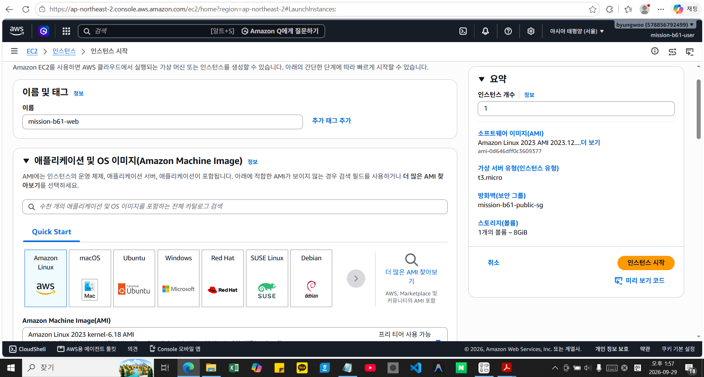

*이름 `mission-b61-web`, AMI Amazon Linux 2023, 오른쪽 요약에 `t3.micro`·보안 그룹 `mission-b61-public-sg`*

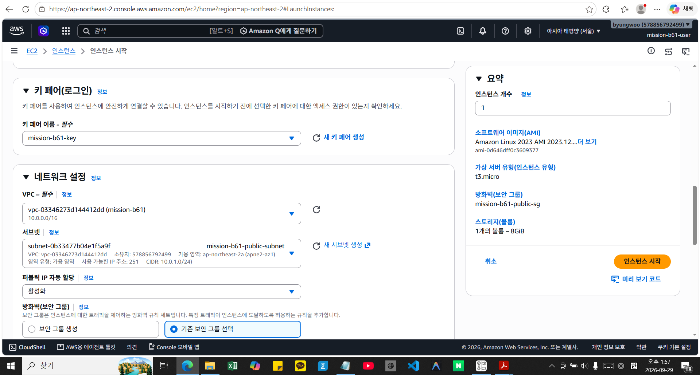

*키 페어 `mission-b61-key`, VPC `vpc-03346273d144412dd (mission-b61)` `10.0.0.0/16`, 서브넷 `mission-b61-public-subnet`, 퍼블릭 IP 자동 할당 "활성화", "기존 보안 그룹 선택"*

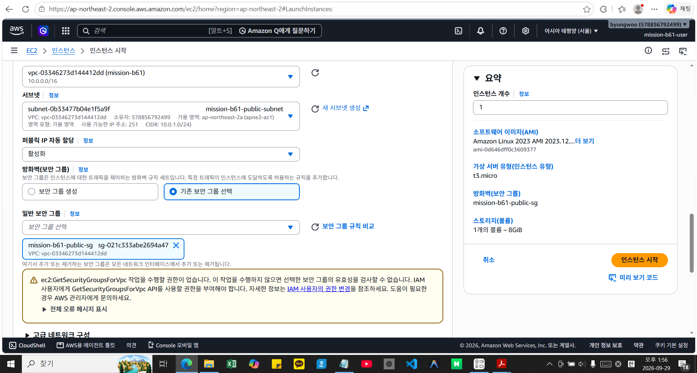

*보안 그룹 `mission-b61-public-sg` 선택. 아래 노란 경고(`ec2:GetSecurityGroupsForVpc` 권한 없음)는 최소 권한 정책 때문에 나타난 검증용 안내이며 시작은 차단되지 않음 ([트러블슈팅 #3](./troubleshooting.md))*

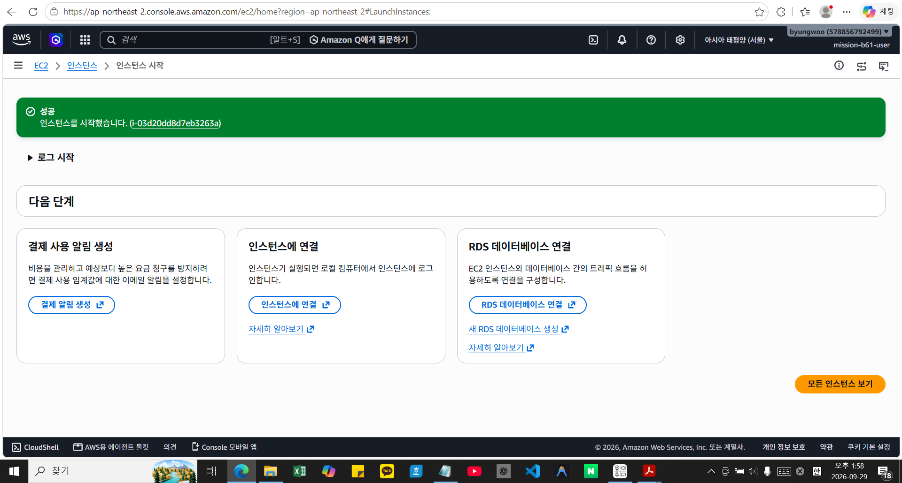

*"성공 — 인스턴스를 시작했습니다. (i-03d20dd8d7eb3263a)"*


*`i-03d20dd8d7eb3263a (mission-b61-web)` — 실행 중, 퍼블릭 IPv4 `43.201.17.39`, 프라이빗 IPv4 `10.0.1.251`*

### 8단계 — SSH 접속

- **목적**: 인스턴스에 원격 접속하여 웹 서버 설치
- **실행 내용**: Windows PowerShell에서 키 파일 권한을 `icacls`로 제한한 뒤 접속
  ```powershell
  icacls mission-b61-key.pem /inheritance:r
  icacls mission-b61-key.pem /grant:r "$($env:USERNAME):(R)"
  ssh -i mission-b61-key.pem ec2-user@43.201.17.39
  ```
- **결과**: 접속 성공, 프롬프트가 `[ec2-user@ip-10-0-1-251 ~]$`로 전환됨

**증빙 — 터미널 출력 기록 (2026-09-29, 발췌)**

```text
PS C:\Users\user\codyssey\본과정_과제\B6-1(작성중)> dir mission-b61-key.pem
Mode                 LastWriteTime         Length Name
-a----      2026-09-29   오후 1:53           1678 mission-b61-key.pem

PS ...> icacls mission-b61-key.pem /inheritance:r
처리된 파일: mission-b61-key.pem
1 파일을 처리했으며 0 파일은 처리하지 못했습니다.
PS ...> icacls mission-b61-key.pem /grant:r "$($env:USERNAME):(R)"
처리된 파일: mission-b61-key.pem
1 파일을 처리했으며 0 파일은 처리하지 못했습니다.
PS ...> ssh -i mission-b61-key.pem ec2-user@43.201.17.39
The authenticity of host '43.201.17.39 (43.201.17.39)' can't be established.
ED25519 key fingerprint is SHA256:hOvQC9tJrU8r2L0nD4LWn0GOYIdjgOK3ivW2CViNhvo.
This key is not known by any other names.
Are you sure you want to continue connecting (yes/no/[fingerprint])? yes
Warning: Permanently added '43.201.17.39' (ED25519) to the list of known hosts.
   (Amazon Linux 2023 배너 생략)
[ec2-user@ip-10-0-1-251 ~]$
```

*키 파일은 1678바이트(`.pem`)이며, 권한을 현재 사용자 읽기 전용으로 제한한 뒤 접속했다. 처음 접속할 때 나오는 호스트 지문 확인 질문에 `yes`로 답했고, 프롬프트의 `ip-10-0-1-251`은 7단계에서 확인한 프라이빗 IP `10.0.1.251`과 일치한다.*

### 9단계 — Nginx 설치 및 실행

- **목적**: 웹 서버 소프트웨어 설치
- **실행 내용**:
  ```bash
  sudo dnf install -y nginx
  sudo systemctl enable --now nginx
  systemctl status nginx
  ```
- **결과**: `Active: active (running)` 확인, 재부팅 시 자동 시작 설정(enable) 완료

**증빙 — 터미널 출력 기록 (2026-09-29, 발췌)**

```text
[ec2-user@ip-10-0-1-251 ~]$ sudo dnf install -y nginx
Dependencies resolved.
Installing:
 nginx                x86_64   1:1.30.5-1.amzn2023.0.1   amazonlinux   34 k
Installing dependencies:
 generic-logos-httpd  noarch   18.0.0-12.amzn2023.0.3    amazonlinux   19 k
 gperftools-libs      x86_64   2.9.1-1.amzn2023.0.3      amazonlinux  308 k
 libunwind            x86_64   1.4.0-5.amzn2023.0.3      amazonlinux   66 k
 nginx-core           x86_64   1:1.30.5-1.amzn2023.0.1   amazonlinux  711 k
 nginx-filesystem     noarch   1:1.30.5-1.amzn2023.0.1   amazonlinux   10 k
 nginx-mimetypes      noarch   2.1.49-3.amzn2023.0.3     amazonlinux   21 k

Transaction Summary
Install  7 Packages
Total download size: 1.1 M
Installed size: 3.8 M
(중략: 패키지 7개 다운로드·설치·검증 진행 출력)
Complete!

[ec2-user@ip-10-0-1-251 ~]$ sudo systemctl enable --now nginx
Created symlink /etc/systemd/system/multi-user.target.wants/nginx.service → /usr/lib/systemd/system/nginx.service.

[ec2-user@ip-10-0-1-251 ~]$ systemctl status nginx
● nginx.service - The nginx HTTP and reverse proxy server
     Loaded: loaded (/usr/lib/systemd/system/nginx.service; enabled; preset: disabled)
     Active: active (running) since Tue 2026-09-29 07:09:42 UTC; 11s ago
   Main PID: 29785 (nginx)
      Tasks: 3 (limit: 1059)
     Memory: 3.6M
        CPU: 57ms
     CGroup: /system.slice/nginx.service
             ├─29785 "nginx: master process /usr/sbin/nginx"
             ├─29786 "nginx: worker process"
             └─29787 "nginx: worker process"

Sep 29 07:09:42 ip-10-0-1-251... nginx[29783]: nginx: configuration file /etc/nginx/nginx.conf test is successful
Sep 29 07:09:42 ip-10-0-1-251... systemd[1]: Started nginx.service - The nginx HTTP and reverse proxy server.
```

*`Loaded: … enabled`는 재부팅 후 자동 시작 설정, `Active: active (running)`은 현재 실행 중이라는 뜻이다. 시각 `07:09:42 UTC`는 한국시간으로 2026-09-29 오후 4:09:42이다. 설치 목록은 화면 폭에 맞춰 열 간격만 줄였고, 상태 출력은 `less` 화면(`lines 1-19/19 (END)`)으로 표시되어 그 잔여 표시는 제외했다.*

### 10단계 — 인스턴스 내부 검증

- **목적**: 웹 서버 응답 및 아웃바운드 통신 확인
- **실행 내용**:
  ```bash
  curl -i http://localhost
  curl -I https://example.com
  ```
- **결과**: `curl localhost` → `HTTP/1.1 200 OK`(Nginx 기본 페이지), `curl example.com` → `HTTP/2 200` — 라우팅 테이블 아웃바운드 경로가 정상 동작함을 확인

**증빙 — 터미널 출력 기록 (2026-09-29, 발췌)**

```text
[ec2-user@ip-10-0-1-251 ~]$ curl -i http://localhost
HTTP/1.1 200 OK
Server: nginx/1.30.5
Date: Tue, 29 Sep 2026 07:11:38 GMT
Content-Type: text/html
Content-Length: 896
Last-Modified: Wed, 16 Sep 2026 21:09:29 GMT
Connection: keep-alive
ETag: "6aab0589-380"
Accept-Ranges: bytes

<!DOCTYPE html>
<html>
<head>
<title>Welcome to nginx!</title>
(중략)
<h1>Welcome to nginx!</h1>
(중략)
</html>

[ec2-user@ip-10-0-1-251 ~]$ curl -I https://example.com
HTTP/2 200
date: Tue, 29 Sep 2026 07:11:55 GMT
content-type: text/html; charset=utf-8
server: cloudflare
last-modified: Mon, 28 Sep 2026 16:19:23 GMT
allow: GET, HEAD
accept-ranges: bytes
age: 9657
cf-cache-status: HIT
cf-ray: a4292d351aea8d31-ICN
```

*첫 번째 `curl`은 인스턴스 안에서 Nginx 기본 페이지가 `200 OK`로 응답함을, 두 번째 `curl`은 인스턴스가 인터넷 쪽 사이트(example.com)에 접속해 `HTTP/2 200`을 받았음을 보여 준다. 두 번째가 성공했다는 것은 5단계의 `0.0.0.0/0 → IGW` 경로와 7단계의 퍼블릭 IP 할당이 제대로 동작한다는 뜻이다. 시각은 한국시간으로 오후 4:11이며, 이어서 4:16에 11단계 외부 접속 화면을 캡처했다.*

### 11단계 — 외부 접속 검증

- **목적**: 과제 핵심 요구사항인 "외부에서 누구나 접속 가능"을 증명
- **실행 내용**: 로컬 브라우저(Edge)에서 `http://43.201.17.39` 접속
- **결과**: "Welcome to nginx!" 페이지 정상 표시 확인, 스크린샷 `docs/screenshots/external-access.png`로 저장


*주소창 `43.201.17.39`(퍼블릭 IP)로 접속한 "Welcome to nginx!" 화면 (작업표시줄 시계: 2026-09-29 오후 4:16). 같은 화면이 `external-access.png`로도 저장되어 있음*

### 12단계 — 산출물 문서 완성

- **목적**: 제출용 문서에 실제 값 반영
- **실행 내용**: README.md의 리소스 표·보안 그룹 규칙·IAM 정보·외부 접속 검증란을 실제 값으로 채움. troubleshooting.md에 오늘 겪은 이슈 3건(계정 정지, CIDR 입력 오류, 권한 경고)을 실제 사례로 기록. cleanup-checklist.md에 삭제 대상 리소스 ID를 표로 정리
- **결과**: `codyssey\연습\B6-1(작성중)\` 폴더에 최종본 반영 완료

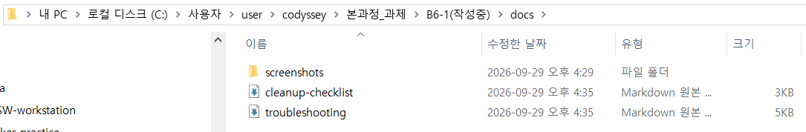

*작업 당일(2026-09-29 오후 4:35) `docs` 폴더 — `screenshots` 폴더, `cleanup-checklist`, `troubleshooting` (당시 폴더 위치는 `본과정_과제\B6-1(작성중)`이었고 이후 `연습\`으로 옮김)*

### 13단계 — 리소스 정리 (2026-10-05)

- **목적**: 과금 방지를 위해 실습 리소스를 의존성 순서대로 삭제하고, 문서 검토 방식 평가에 대비해 증빙을 남김
- **사전 준비**: 삭제 전에만 찍을 수 있는 증빙 스크린샷(`evidence-vpc-map`, `evidence-sg-rules`, `evidence-ec2`, `evidence-dashboard-before`)을 저장하고, 문서·스크린샷을 zip(`.pem` 제외)으로 묶어 컴퓨터 밖(네이버 메일)을 포함해 여러 곳에 백업
- **실행 내용**: 삭제 확인 창마다 대상 ID가 의도한 것 하나뿐인지 확인한 뒤 진행했고, AWS 기본 VPC 관련 리소스는 건드리지 않음

| 순서 | 대상 | 결과 | 증빙 파일 |
|---|---|---|---|
| 1 | EC2 인스턴스 `i-03d20dd8d7eb3263a` | 종료됨, 퍼블릭 IP 반납 | `evidence-ec2-terminated.png` |
| 2 | EBS 볼륨 | 0개 (루트 볼륨 동반 삭제) | `evidence-ebs-empty.png` |
| 3 | 보안 그룹 `sg-021c333abe2694a47` | 삭제 | `cleanup-sg-deleted.png` |
| 4 | 인터넷 게이트웨이 `igw-016323813992e2cf6` | VPC에서 분리 → 삭제 | `cleanup-igw-detached.png`, `cleanup-igw-deleted.png` |
| 5 | 서브넷 `subnet-0b33477b04e1f5a9f` | 삭제 | `cleanup-subnet-deleted.png` |
| 6 | VPC `vpc-03346273d144412dd` (기본 라우팅 테이블 등 동반 삭제) | 삭제 | `evidence-dashboard-after.png` |
| 7 | 키 페어 `mission-b61-key` | 삭제 | `cleanup-keypair-deleted.png` |

**증빙 화면 — 삭제 전 (삭제하기 전에만 찍을 수 있는 화면)**


*`evidence-vpc-map` — VPC 리소스 맵 (VPC·서브넷·라우팅 테이블·IGW 구성)*


*`evidence-sg-rules` — 보안 그룹 `mission-b61-public-sg`의 인바운드 규칙 (80, 22)*


*`evidence-ec2` — 인스턴스 상세 (실행 중, 퍼블릭 IP `43.201.17.39`)*


*`evidence-dashboard-before` — 삭제 전 VPC 대시보드 리소스 개수 (VPC 2, 서브넷 5, 라우팅 테이블 2, IGW 2, 보안 그룹 3)*

**증빙 화면 — 삭제 과정 (의존성 순서)**

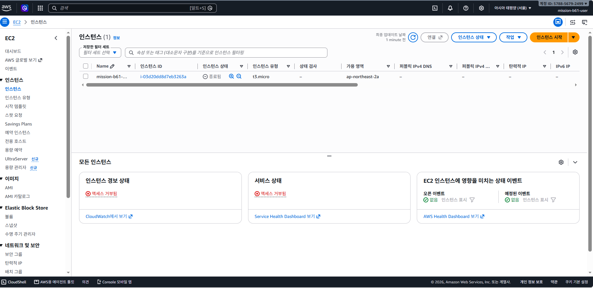

*1. `evidence-ec2-terminated` — 인스턴스 종료됨*

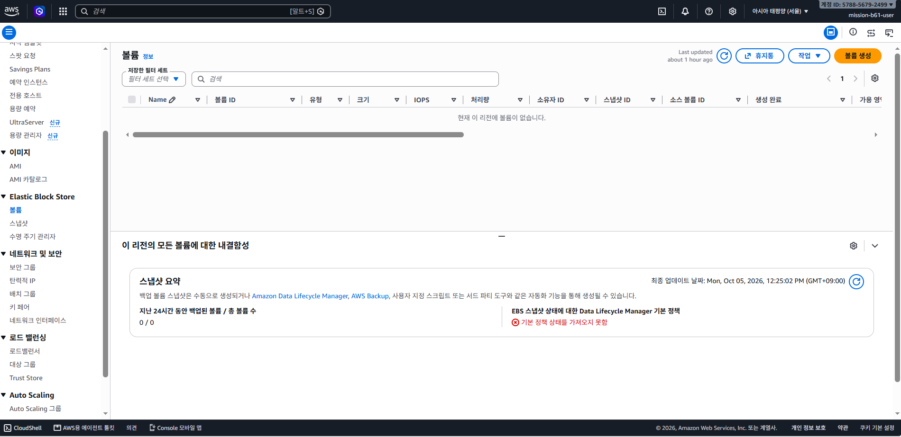

*2. `evidence-ebs-empty` — 볼륨 0개 (루트 볼륨은 인스턴스와 함께 삭제)*

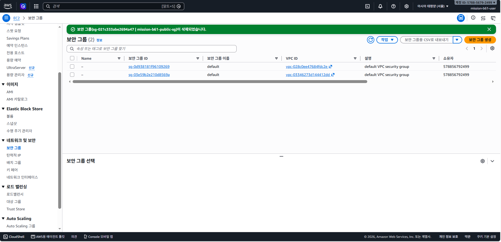

*3. `cleanup-sg-deleted` — 보안 그룹 삭제*

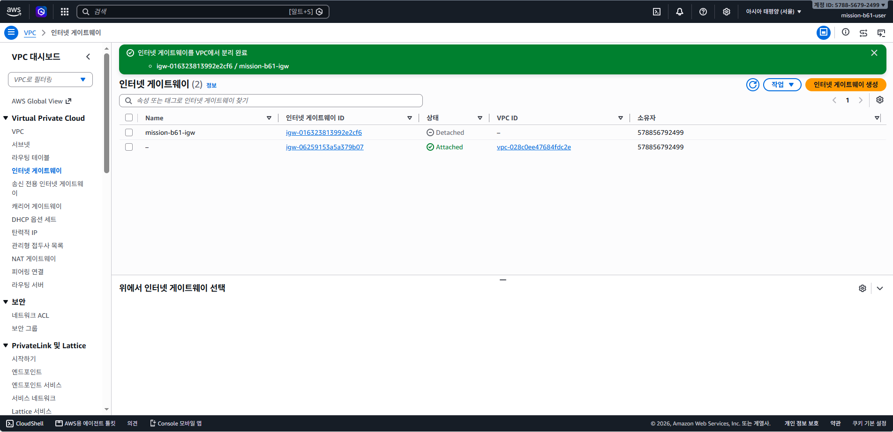

*4-1. `cleanup-igw-detached` — 인터넷 게이트웨이를 VPC에서 분리(Detach)*

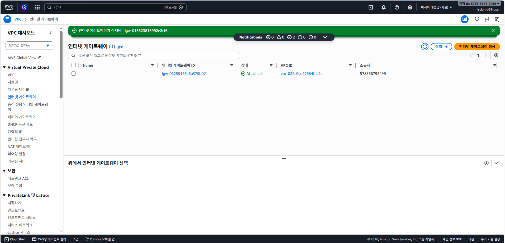

*4-2. `cleanup-igw-deleted` — 인터넷 게이트웨이 삭제*

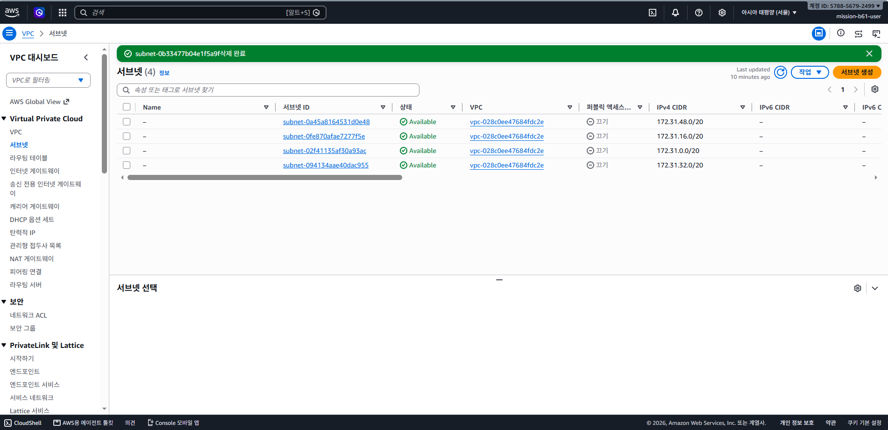

*5. `cleanup-subnet-deleted` — 서브넷 삭제*

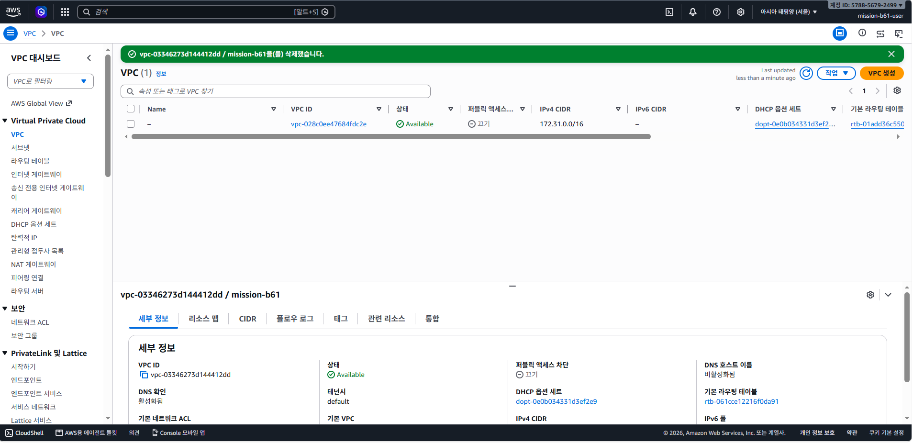

*6. `cleanup-vpc-deleted` — VPC 삭제*


*7. `cleanup-keypair-deleted` — "1개의 키 페어 삭제 완료"와 빈 목록*

**증빙 화면 — 삭제 후 확인**


*`evidence-dashboard-after` — 삭제 후 VPC 대시보드 (VPC 1, 서브넷 4, 라우팅 테이블 1, IGW 1, 보안 그룹 1 — 모두 AWS 기본 VPC 기본값)*


*`evidence-ec2-dashboard-after` — EC2 대시보드: 인스턴스(실행 중) 0, 볼륨 0, 탄력적 IP 0 (키 페어 카드 1은 키 페어 삭제 직전에 캡처했기 때문)*


*`cleanup-billing-denied` — 최소 권한 사용자는 결제 화면 조회가 "액세스 거부됨"*

- **결과**: VPC 대시보드 개수가 삭제 전 → 후 VPC 2→1, 서브넷 5→4, 라우팅 테이블 2→1, IGW 2→1, 네트워크 ACL 2→1, 보안 그룹 3→1로 바뀌어 남은 것은 모두 AWS 기본 VPC 기본값임을 확인. EC2 대시보드(`evidence-ec2-dashboard-after.png`)에서 인스턴스(실행 중)·볼륨·탄력적 IP가 모두 0. 이 캡처는 키 페어 삭제 직전이라 키 페어 카드만 1로 표시되었고, 직후 키 페어 목록 화면에서 "1개의 키 페어 삭제 완료"와 빈 목록을 확인(`cleanup-keypair-deleted.png`)
- **결제 확인**: IAM 최소 권한 사용자는 결제 화면 조회가 허용되지 않아 "액세스 거부됨"으로 표시됨(`cleanup-billing-denied.png`). 과금 원인 리소스가 모두 0개인 위 화면들로 갈음함
- **참고**: 일부 화면에 최소 권한 정책 범위 밖 서비스(Compute Optimizer, RAM 등)의 "권한 없음" 안내가 표시되었으나 삭제 동작에는 영향이 없었음([트러블슈팅 #3 참고 항목](./troubleshooting.md))

## 2. 최종 검증 결과 요약

| 검증 항목 | 결과 |
|---|---|
| VPC/Subnet/IGW/Route Table 구성 | 정상 |
| 보안 그룹 규칙 (80 공개, 22 제한) | 정상 |
| SSH 접속 | 정상 |
| Nginx 실행 상태 | active (running) |
| 인스턴스 내부 `curl localhost` | HTTP/1.1 200 OK |
| 인스턴스 아웃바운드 `curl example.com` | HTTP/2 200 |
| 외부 브라우저 접속 | 정상 ("Welcome to nginx!" 확인) |
| IAM 최소 권한 사용자로 구축·정리 수행 | 정상 (루트 계정은 가입·IAM 사용자 생성에만 사용) |
| 정리 후 과금 원인 리소스 | 0개 (VPC·EC2 대시보드 확인, 결제 화면은 최소 권한으로 조회 불가) |

## 3. 발생한 트러블슈팅 (요약)

상세 원인·조치 내용은 [`troubleshooting.md`](./troubleshooting.md) 참조.

1. AWS 계정 가입 중 브라우저 뒤로 가기로 흐름이 끊겨 계정이 정지됨 → 다른 이메일로 재가입 (2026-09-28)
2. VPC 서브넷 생성 시 CIDR 입력 칸이 반영되지 않음 → 입력 칸 포커스 재확인으로 해결
3. EC2 인스턴스 시작 시 보안 그룹 검증 권한 경고 발생 → 실제 생성에는 영향 없음을 확인, 조치 불필요
4. 정리 단계에서 최소 권한 정책 범위 밖 서비스 화면에 "권한 없음" 안내가 표시됨 → 삭제 동작에는 영향 없음 (#3 참고 항목에 함께 기록)

## 4. 산출물 목록

- [`README.md`](../README.md) — 프로젝트 개요 및 리소스 구성 요약
- [`architecture.png`](./architecture.png) — 아키텍처 다이어그램
- [`troubleshooting.md`](./troubleshooting.md) — 트러블슈팅 보고서
- [`cleanup-checklist.md`](./cleanup-checklist.md) — 리소스 정리 체크리스트 (정리 완료 기록)
- [`screenshots/`](./screenshots/) — 증빙 스크린샷 (`stepNN-…` = 구축 단계별 화면, `evidence-…`/`cleanup-…` = 삭제 전 구성·삭제 단계별·삭제 전후 대시보드·결제 조회 불가 화면, `external-access` = 외부 접속)
- `execution-report.md` (본 문서) — 단계별 실행보고서

## 5. 진행 현황

- [x] 삭제 전 백업·증빙 확보 (`cleanup-checklist.md` 0단계) — 평가는 문서 검토 방식이므로 서류와 스크린샷이 증빙이 됨
- [x] AWS 리소스 정리 (EC2 종료 → 보안 그룹 → IGW 분리/삭제 → 서브넷 → VPC → 키 페어)
- [x] 정리 후 과금 원인 리소스 0개 확인 (결제 화면은 최소 권한으로 조회 불가 — 대체 증빙으로 갈음)
- [x] 최종 재백업 (2026-10-06) — 정리 결과가 반영된 문서·스크린샷 zip(25개 파일)을 네이버 내게쓰기로 전송, `.pem` 제외 확인
- [x] 실행보고서 각 단계에 작업 당시 증빙 연결 (0~7·11·12·13단계는 스크린샷, 8~10단계는 터미널 출력 기록 발췌)
- [x] IAM 사용자·정책은 요금이 없어 이번 정리에서 삭제하지 않고 유지 (필요 없어지면 콘솔 IAM에서 삭제)
- [ ] (선택) 보너스 과제: HTTPS 적용, Docker 배포
