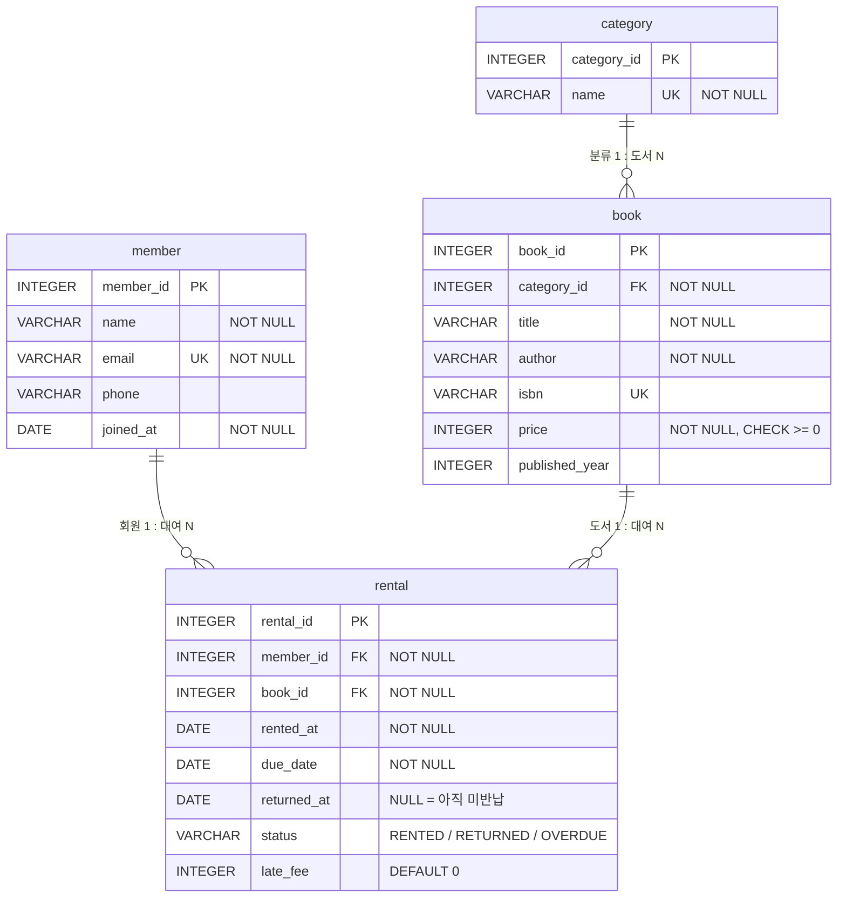

# 도서 대여 데이터베이스 (SQL 실습)

도서관의 **회원 · 도서 · 분류 · 대여 기록**을 4개의 테이블로 설계하고, 샘플 데이터를 넣은 뒤, 요구사항을 **SQL 쿼리 15개**로 해결한 실습 결과물입니다.
(백엔드 프레임워크 없이 순수 SQL 만 사용 · DB 는 **SQLite 3**)

```
설계(ERD · 스키마)  ─▶  샘플 데이터 입력(INSERT)  ─▶  쿼리 15개 실행(SELECT / JOIN / GROUP BY / UPDATE / DELETE / INDEX)  ─▶  결과 텍스트 저장
```

> 💡 **동료평가 설명용 자료**: 브라우저에서 [`동료평가_설명자료.html`](동료평가_설명자료.html) 을 열면 개념 사전 · ERD · 쿼리별 해설 · 발표 대본 · 예상 질문이 한 페이지에 정리되어 있습니다.

---

## 1. 폴더 구조

```
B6/
├── README.md                    # 지금 보는 문서
├── 동료평가_설명자료.html         # 초급자용 시각 설명서 + 발표 대본 + 예상 Q&A
├── sql/
│   ├── 01_schema.sql            # ① 스키마 생성 (CREATE TABLE ×4, PK/FK/제약조건)
│   ├── 02_insert_data.sql       # ② 샘플 데이터 입력 (부모 → 자식 순서)
│   └── 03_queries.sql           # ③ 핵심 쿼리 15개 (쿼리마다 한 줄 설명 주석)
├── results/                     # ④ 실행 결과 캡처(텍스트)
│   ├── 00_verify.txt            #    행 수 · FK 목록 · 제약조건 동작 검증
│   ├── Q01.txt ~ Q15.txt        #    쿼리별 SQL + 실행 결과
│   ├── all_results.txt          #    전체 모음
│   └── results.json             #    설명자료 생성에 쓴 원본 데이터
├── erd.svg                      # ERD 이미지
├── run_all.py                   # SQL 3개를 순서대로 실행하고 results/ 를 자동 생성하는 스크립트
├── library.db                   # 실행이 끝난 SQLite DB 파일 (DBeaver 등으로 열람 가능)
└── 과제 6번.txt                  # 과제 원문
```

## 2. 실행 방법

**요구사항:** Python 3.8 이상 (SQLite 는 파이썬에 내장되어 있어 별도 설치가 필요 없습니다)

### 방법 A. 한 번에 실행 (권장)

```powershell
cd B6
python run_all.py
```

`library.db` 를 지우고 새로 만든 뒤 `01 → 02 → 03` 을 순서대로 실행하고 `results/` 를 갱신합니다. 몇 번을 실행해도 결과가 같습니다.

### 방법 B. 직접 접속해서 쿼리 쳐 보기

```powershell
python -m sqlite3 library.db        # 파이썬 3.12 이상은 sqlite3 셸 내장
```

```sql
PRAGMA foreign_keys = ON;           -- SQLite 는 접속할 때마다 켜야 FK 가 동작합니다
SELECT * FROM member;
.quit
```

### 방법 C. DB 도구 (DBeaver / DataGrip / TablePlus 등)

1. SQLite 연결을 만들고 `library.db` 를 엽니다. (또는 새 DB 를 만들어 `sql/01 → 02 → 03` 을 순서대로 실행)
2. 스크립트는 **반드시 01 → 02 → 03 순서**로 실행해야 합니다. (FK 부모 테이블이 먼저 있어야 하고, Q13 · Q14 는 데이터를 실제로 바꾸기 때문)

> ⚠️ `03_queries.sql` 의 Q13(UPDATE) · Q14(DELETE) 는 데이터를 변경합니다. 처음 상태로 되돌리려면 `python run_all.py` 를 다시 실행하세요.

## 3. 데이터 모델



이미지 버전: [`erd.svg`](erd.svg)

| 테이블 | 역할 | 행 수 | 부모 테이블(FK) |
|---|---|---:|---|
| `category` | 도서 분류 | 10 | – |
| `member` | 회원 | 12 | – |
| `book` | 도서 | 24 | `category` |
| `rental` | 대여 기록 (회원 ↔ 도서 연결) | 38 | `member`, `book` |

- **1:N 관계 3개** : 분류 1 : 도서 N / 회원 1 : 대여 N / 도서 1 : 대여 N (FK 는 항상 N 쪽 테이블에 있음)
- 행 수는 `02_insert_data.sql` 직후 기준입니다. (Q14 에서 회원 1명을 삭제하므로 최종 member 는 11행)

### 적용한 제약조건

| 제약 | 적용 위치 |
|---|---|
| PRIMARY KEY | 4개 테이블의 `*_id` (자동 증가) |
| FOREIGN KEY (`ON DELETE RESTRICT`) | `book.category_id`, `rental.member_id`, `rental.book_id` |
| NOT NULL | 이름 · 이메일 · 제목 · 저자 · 가격 · 대여일 · 반납예정일 · 상태 · 연체료 등 |
| UNIQUE | `category.name`, `member.email`, `book.isbn` |
| CHECK | `book.price >= 0`, `rental.status IN (...)`, `rental.due_date >= rented_at`, `rental.late_fee >= 0` |
| DEFAULT | `rental.status = 'RENTED'`, `rental.late_fee = 0` |

### FK 가 실제로 동작한다는 증거

`results/00_verify.txt` 에 일부러 잘못된 입력을 시도한 결과가 있습니다. (시도 후 자동 롤백)

| 시도 | 결과 |
|---|---|
| 없는 회원(999번)으로 대여 기록 INSERT | `FOREIGN KEY constraint failed` |
| 없는 도서(999번)로 대여 기록 INSERT | `FOREIGN KEY constraint failed` |
| 없는 분류(99번)로 도서 INSERT | `FOREIGN KEY constraint failed` |
| 대여 기록이 있는 도서 · 회원 DELETE | `FOREIGN KEY constraint failed` |
| 이름 NULL / 중복 이메일 / 음수 가격 / 잘못된 상태값 | NOT NULL · UNIQUE · CHECK 위반으로 거부 |

## 4. 핵심 쿼리 15개

각 쿼리 위의 `-- Qn. [분류] 설명` 한 줄이 “무엇을 확인하는 쿼리인지” 설명입니다. 결과는 `results/Qnn.txt` 에 있습니다.

| # | 분류 | 무엇을 확인하나 | 사용 문법 |
|---|---|---|---|
| Q1 | 기본 조회 | 정가 20,000원 이상 도서를 비싼 순으로 5권 | WHERE · ORDER BY · LIMIT |
| Q2 | 기본 조회 | 제목에 ‘파이썬’ 이 들어간 도서 검색 | LIKE |
| Q3 | 기본 조회 | 최근 30일 대여 기록 최신 10건 | 날짜 조건 `date()` ※SQLite 전용 |
| Q4 | 기본 조회 | 대여 중인 기록을 반납 예정일 빠른 순 5건 | WHERE · ORDER BY · LIMIT |
| Q5 | 조인 | 도서 + 분류 이름 | **INNER JOIN** |
| Q6 | 조인 | 대여 중인 책 목록 (회원 · 책 · 기한) | **INNER JOIN** ×2 (3개 테이블) |
| Q7 | 조인 | 한 번도 대여된 적 없는 도서 | **LEFT JOIN** + IS NULL |
| Q8 | 조인 | 회원별 대여 횟수 (0건 회원 포함) | **LEFT JOIN** + COUNT + GROUP BY |
| Q9 | 집계 | 분류별 도서 수와 평균 가격 | COUNT · AVG · GROUP BY |
| Q10 | 집계 | 가장 많이 대여된 도서 TOP 5 | JOIN · COUNT · GROUP BY · LIMIT |
| Q11 | 집계 | 연체료 합계 1,500원 이상인 회원 | SUM · GROUP BY · HAVING |
| Q12 | 서브쿼리 | 대여 기록이 한 건도 없는 회원 | `NOT IN (SELECT …)` |
| Q13 | 수정 | 기한 지난 ‘대여 중’ → ‘연체’ 로 변경 + 연체료 계산 | **UPDATE** (전 · 후 SELECT 확인) |
| Q14 | 삭제 | 대여 기록 없는 회원 탈퇴 처리 | **DELETE** + NOT EXISTS (전 · 후 확인) |
| Q15 | 인덱스 | `rental.member_id` 인덱스 생성, SCAN → SEARCH 확인 | CREATE INDEX · EXPLAIN QUERY PLAN |

### 결과 예시 — Q10 인기 도서 TOP 5

```
SELECT b.title, COUNT(*) AS rental_count
FROM rental AS r
INNER JOIN book AS b ON b.book_id = r.book_id
GROUP BY b.book_id, b.title
ORDER BY rental_count DESC, b.title
LIMIT 5;

+----------------------+--------------+
| title                | rental_count |
+----------------------+--------------+
| 혼자 공부하는 파이썬 |            5 |
| 아몬드               |            4 |
| 점프 투 파이썬       |            4 |
| 아주 작은 습관의 힘  |            3 |
| 클린 코드            |            3 |
+----------------------+--------------+
```

### 인덱스 적용 이유 (Q15)

`rental` 은 계속 쌓이는 테이블이고 “특정 회원의 대여 기록”을 자주 찾기 때문에(JOIN · WHERE 에 `member_id` 사용) `member_id` 에 인덱스를 만들었습니다.
인덱스가 없으면 `SCAN rental`(전체 읽기), 있으면 `SEARCH rental USING INDEX idx_rental_member_id`(색인으로 바로 찾기)로 실행 계획이 바뀝니다.

## 5. 요구사항 체크

| 요구사항 | 충족 | 위치 |
|---|:---:|---|
| 로컬 DB 준비 (SQLite) | ✅ | `library.db`, `run_all.py` |
| 테이블 4개 이상 / 각 테이블 PK | ✅ 4개 | `sql/01_schema.sql` |
| FK 로 1:N 관계 2개 이상 | ✅ 3개 | `sql/01_schema.sql`, `erd.svg` |
| NOT NULL · UNIQUE 적용 | ✅ | `sql/01_schema.sql` |
| FK 가 실제로 동작 (없는 값 참조 차단) | ✅ | `results/00_verify.txt` |
| 각 테이블 10행 이상 / 부모 → 자식 순서 입력 | ✅ 10 · 12 · 24 · 38 | `sql/02_insert_data.sql` |
| 기본 조회 4개 이상 | ✅ Q1 ~ Q4 | `sql/03_queries.sql` |
| 조인 4개 이상 (INNER 2+, LEFT 1+) | ✅ INNER 2 + LEFT 2 | Q5 ~ Q8 |
| 집계 3개 이상 (COUNT · SUM · AVG 중 2종 + GROUP BY) | ✅ COUNT · AVG · SUM | Q9 ~ Q11 |
| 서브쿼리 1개 이상 | ✅ | Q12 |
| UPDATE · DELETE 2개 이상 | ✅ | Q13 · Q14 |
| 인덱스 1개 이상 + 적용 이유 | ✅ | Q15 |
| 쿼리마다 한 줄 설명 | ✅ | `-- Qn.` 주석 |
| 실행 결과 (스크린샷 또는 텍스트) | ✅ 텍스트 | `results/` |
| ERD (선택) | ✅ | `erd.svg` |
| 프레임워크 · 뷰 · 프로시저 · 트리거 미사용 | ✅ | – |

> 실행 결과는 과제가 허용하는 **결과 텍스트**로 남겼습니다. 스크린샷이 필요하면 DBeaver 로 `library.db` 를 열어 `sql/03_queries.sql` 을 실행한 화면을 캡처하세요.

## 6. SQLite 전용 문법 (다른 DB 로 옮길 때 바꿔야 하는 곳)

SQL 파일 안에 `[SQLite 전용]` 주석으로 표시해 두었습니다. 나머지(SELECT · JOIN · GROUP BY · 서브쿼리 · UPDATE · DELETE)는 표준 SQL 입니다.

| 문법 | 위치 | 다른 DB 에서는 |
|---|---|---|
| `PRAGMA foreign_keys = ON` | 01 · 02 · 03 상단 | MySQL · PostgreSQL 은 기본으로 FK 검사 ON (불필요) |
| `INTEGER PRIMARY KEY AUTOINCREMENT` | 01 | MySQL `AUTO_INCREMENT` / PostgreSQL `GENERATED ALWAYS AS IDENTITY` |
| `DATE` 컬럼을 `'YYYY-MM-DD'` 문자열로 저장 | 01 | 대부분 진짜 DATE 타입 지원 |
| `date('2026-10-08', '-30 day')` | Q3 | MySQL `DATE_SUB(..., INTERVAL 30 DAY)` / PostgreSQL `date - 30` |
| `julianday()` 로 날짜 차이 계산 | Q13 | MySQL `DATEDIFF()` / PostgreSQL `date - date` |
| `EXPLAIN QUERY PLAN` | Q15 | MySQL · PostgreSQL 은 `EXPLAIN` |

## 7. 설계 메모

- **기준일 고정** : “최근 30일”, “기한 지남” 같은 쿼리가 실행하는 날에 따라 달라지지 않도록 오늘을 `2026-10-08` 로 고정했습니다. 실제 서비스라면 `date('now')` 를 씁니다.
- **ON DELETE RESTRICT** : 대여 기록이 남아 있는 회원 · 도서를 지우면 기록이 주인 없는 번호가 되므로 삭제를 막았습니다.
- **정규화** : “같은 정보를 반복 저장하지 않는다”는 핵심만 적용했습니다. (회원 · 도서 · 분류 정보는 각각 1번만 저장하고 대여 기록은 번호로 참조)
- **COUNT(r.rental_id)** : Q8 에서 LEFT JOIN 후 `COUNT(*)` 를 쓰면 대여가 없는 회원도 1건으로 세어지므로, NULL 을 제외하고 세는 `COUNT(컬럼)` 을 썼습니다.
- 모든 이름 · 이메일 · 전화번호 · ISBN 은 실습용 가상 데이터입니다.
